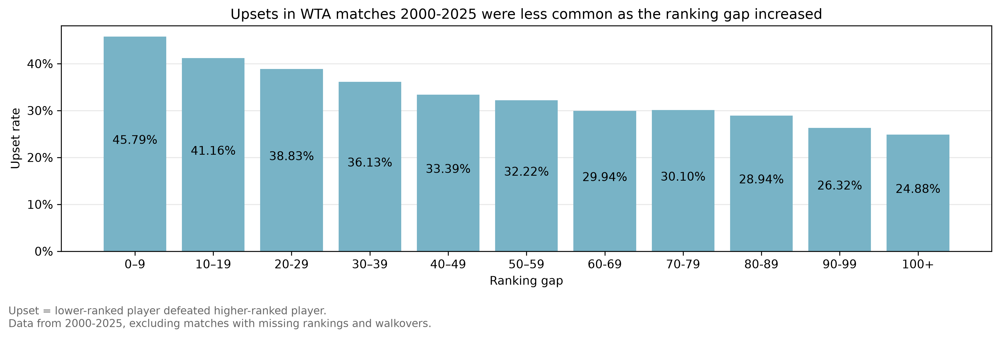
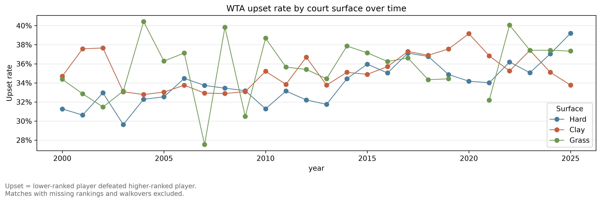
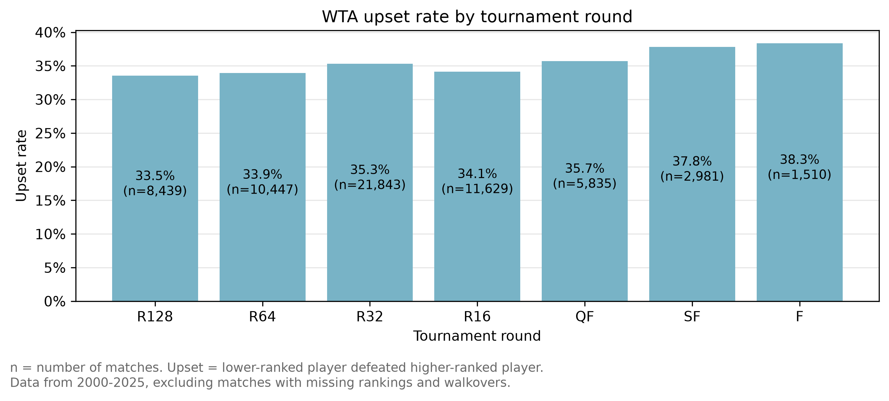

# WTA Tennis 2000-2025 
This project investigates how frequently lower-ranked players defeated
higher-ranked players during the WTA seasons 2000 - 2025.

## Questions

1. What proportion of matches were upsets?
2. Did upset rates differ between surfaces?
3. How did the ranking gap relate to upset frequency?
4. Did upset rates differ between tournament rounds?

## Data

The analysis uses WTA match data from 2000 to 2025 compiled by Jeff Sackmann. They are
redistributed under the Creative Commons Attribution-NonCommercial-ShareAlike
4.0 International License (CC BY-NC-SA 4.0), the license under which they are
originally released. 
These were accessed via the archive repository found at https://github.com/Aneeshers/tennis-sackmann-archive/tree/main/wta.

This is a descriptive analysis. It identifies patterns but does not establish
that surface or tournament round causes an upset.

Matches without rankings and matches decided by walkover were excluded.
An upset was defined as a match where the winner had a numerically higher
ranking than the loser.

## Folder guide

The notebooks are designed as follows.
- `01_exploration.ipynb`: data cleaning and exploratory analysis
- `02_feature_engineering.ipynb`: feature engineering
- `03_baseline_model.ipynb`: logistic regression model

The data folder contains two subfolders.
- raw: original data files downloaded from Jeff Sackmanns archive.
- processed: saves data that is cleaned and engineered in the notebooks.

The figures folder contains all figures obtained by running the notebook `01_exploration.ipynb`.


## Findings

### The exploratory data analysis

We analysed WTA matches from 2000 to 2025 and found the following.

- The upset rate decreased as the ranking gap increased. When the two players had a difference in ranking less than 10, the upset rate was 45.8%, compared with a lower than 30% upset rate for players with a difference in rankings over 60.
  
- Between hard, grass and clay surfaces, there was no clear pattern in which surface had the highest upset rate each year.
  
- The upset rate increased as the tournament rounds progressed, that is, on average there were more upsets in later rounds than in early rounds. There was an upset rate of 33.5% in round of 128 matches, compared with an upset rate of 38.3% amongst matches played in finals.






### The logistic regression model

- None of the matches were predicted an upset probability above the threshold of 50%.

- The 30 matches with the highest upset prediction probabilities contained 1.33x more real upsets on average than the overall rate; 50% of the top 30 matches were real upsets, compared with 37.6% overall.

- The logistic regression model had a ROC-AUC of 0.60, higher than the baseline 0-model (always predicting an upset) that has an ROC-AUC of 0.5. This suggests the model assigned a higher probability of an upset to matches that were real upsets than on average.


### Limitations

- The model uses only ranking gap, court surface, tournament round, and
  tournament level. It does not include player form, injuries, head-to-head
  records, recent workload, or surface-specific performance.

- Matches with missing rankings and walkovers were excluded. This may mean
  that the analysed matches are not perfectly representative of all WTA
  matches.

- The disrupted 2020 season was excluded from modelling. This makes the
  training data more representative of typical seasons, but reduces the
  amount of available historical data.

- Upsets are the minority outcome. As a result, a model can achieve reasonable
  accuracy by predicting no upset for every match, so accuracy alone is not a
  sufficient evaluation measure.

- The baseline model did not predict any upsets at the default 50% threshold.
  Although its probability rankings may still contain useful information, it
  is not yet suitable as a direct yes/no upset predictor.

### Next steps

- Add more features to the model, such as recent individual player data and current form.

- Compare the logistic-regression baseline with more flexible models, for example lowering the upset threshold.


## How to run the project

### 1. Download the data

Download the WTA match CSV files for 2000–2025 from the
[tennis-sackmann archive](https://github.com/Aneeshers/tennis-sackmann-archive).

Place the downloaded CSV files in:

data/raw/

The raw data is not included in this repository.

### 2. Set up Python

On a Mac, from the project folder:


```bash
python3 -m venv .venv
source .venv/bin/activate
python -m pip install -r requirements.txt
```

Open the project folder in VS Code and select the .venv Python interpreter/kernel.
### 3. Run the notebooks in order

1. '01_exploration.ipynb' Combines and cleans the raw WTA match files, creates exploratory charts, and saves data/processed/combined_data.csv.
2. '02_feature_engineering.ipynb' Creates modelling features and saves data/processed/model_data_baseline.csv.
3. '03_baseline_model.ipynb' Trains and evaluates a logistic-regression model using 2025 as the test year.
